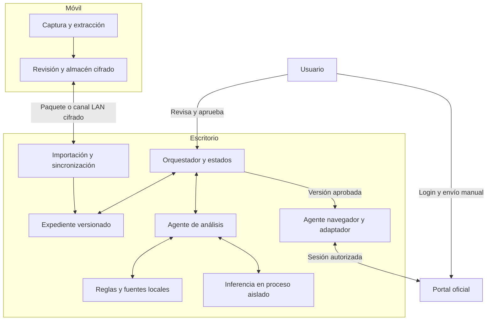

# FODIBO — Arquitectura de software

**Versión 2.1 · 5 de noviembre de 2026**  
**Estado:** arquitectura objetivo y stack recomendado; pendiente de validación técnica.  
**Ámbito:** móvil, transferencia local y escritorio para preparar declaraciones fiscales en Suiza.

**Estado actual de FODIBO (según el análisis del APK):** La aplicación existente es una solución móvil Android desarrollada en Flutter/Dart, con integración nativa mediante `MethodChannel` para OCR basado en Google ML Kit. Permite procesar imágenes y documentos PDF, reconocer texto en el dispositivo y extraer datos de recibos mediante `ReceiptOcrParser`, que utiliza expresiones regulares, heurísticas y comprobaciones aritméticas para identificar comercios, fechas, importes e impuestos. El APK también muestra funciones de precarga de campos, sugerencias, detección de duplicados, manejo de múltiples archivos y caché de OCR. La extracción actual depende principalmente de patrones y presenta limitaciones para interpretar semánticamente documentos complejos o desgloses de productos. La sincronización móvil–PC, la aplicación de escritorio, los agentes de análisis fiscal y el llenado asistido del portal forman parte de la arquitectura propuesta, no de las capacidades verificadas en el APK.

## 1. Objetivo, alcance y decisiones

FODIBO convierte documentos en un expediente fiscal verificable: captura y extracción móvil, análisis local con preguntas y recomendaciones, y llenado asistido del portal oficial. El usuario confirma los datos, inicia sesión y realiza personalmente la presentación.

**Decisiones estructurales:**

- **Procesamiento local:** captura, extracción, inferencia y cálculos se ejecutan en los dispositivos. La red local sirve para transferir; Internet se habilita exclusivamente para el portal. Las actualizaciones se importan como paquetes obtenidos aparte.
- **Escritorio como monolito modular:** un núcleo coordina almacenamiento, reglas y agentes; inferencia y contenido web se ejecutan en procesos separados. No se requiere backend central.
- **IA acotada:** el LLM interpreta y propone; el motor fiscal calcula y valida; el usuario aprueba. Los agentes acceden mediante herramientas limitadas.
- **Independencia del portal:** siempre se puede preparar, revisar y exportar el expediente, aunque el llenado automático no esté disponible.

Se conservan la captura, el OCR y `ReceiptOcrParser` descritos como existentes en la versión anterior, sujetos a revisión del código. Sincronización, escritorio y agentes son componentes propuestos. El diseño contempla recibos, certificados salariales, documentos bancarios y otros justificantes; requieren extractores por tipo.

## 2. Componentes y despliegue

| Componente | Responsabilidad y frontera |
| --- | --- |
| Captura y extracción | Conserva originales; obtiene texto y campos. Reglas primero, SLM ante ambigüedad; resultados sujetos a validación. |
| Expediente y sincronización | Único acceso a persistencia; controla revisiones, evidencias, importaciones y conflictos. |
| Orquestador | Gestiona trabajos persistentes, permisos, estados, cancelación y recuperación. No toma decisiones fiscales. |
| Agente de análisis | Clasifica, consulta fuentes locales, propone deducciones y formula preguntas. No aprueba datos ni navega. |
| Motor fiscal | Evalúa reglas por ejercicio y jurisdicción; calcula importes, límites y consistencia con trazabilidad. |
| Agente navegador | Consume una versión aprobada; ejecuta acciones del adaptador y verifica el resultado. No modifica el expediente ni presenta. |

La UI se comunica con el núcleo mediante IPC tipado y validado. El motor de inferencia recibe únicamente el contexto necesario por canal local privado. Solo el servicio de transferencia escucha en la LAN, durante una sesión iniciada por el usuario.

## 3. Modelo de datos y contratos

Contratos JSON versionados mediante `schema_version`; identificadores UUID estables. La base de datos interna no es el formato de intercambio.

| Entidad | Contenido mínimo |
| --- | --- |
| **Expediente** | `case_id`, contribuyentes, ejercicio, jurisdicción, revisión y versión normativa. |
| **Documento** | `document_id`, `case_id`, tipo, original inmutable, MIME, SHA-256, OCR con página/posición cuando exista, revisión y dispositivo de origen. |
| **Campo y evidencia** | Nombre, valor tipado, moneda/unidad, origen —regla, modelo o usuario—, documento/página, estado de revisión e historial de correcciones. |
| **Propuesta fiscal** | Concepto, regla y versión, entradas, resultado, evidencia, justificación y preguntas pendientes. |
| **Declaración aprobada** | Campos fiscales normalizados, documentos autorizados, revisión del expediente, versión normativa, aprobador y huella de contenido. |
| **Paquete de intercambio** | `package_id`, esquema, revisiones base, manifiesto de archivos y hashes, cambios y recibo de importación. |

Importes como decimales exactos, con moneda explícita; fechas documentales ISO y eventos en UTC. Una puntuación del modelo nunca equivale a aprobación.

**Autoridad:** tras la primera importación, Desktop mantiene la revisión canónica del expediente. El móvil conserva capturas y envía cambios basados en una revisión; recibe confirmaciones y correcciones. Los originales permanecen inmutables y cada modificación relevante registra actor, fecha, valor anterior y nuevo.

**Estados:** documento `capturado → extraído → pendiente de revisión → confirmado`; expediente `incompleto → revisable → aprobado`. La sesión del portal tiene estados propios: `preparada → rellenando → pausada/verificada → control manual`. Un cambio de datos o normativa invalida las aprobaciones dependientes y pausa el llenado en curso.

## 4. Flujo operativo y recuperación

1. **Capturar y revisar.** Comprobar legibilidad; extraer texto de PDF cuando exista y aplicar OCR a páginas escaneadas. `ReceiptOcrParser` procesa recibos; otros extractores gestionan los demás tipos. Campos ambiguos quedan pendientes; el usuario puede corregirlos sin IA.
2. **Importar.** Validar esquema, integridad, tamaños y rutas; persistir los archivos antes de confirmar los metadatos en una transacción. Limpiar archivos huérfanos tras interrupciones y confirmar recepción solo después de persistir todo.
3. **Analizar.** Recuperar fuentes del ejercicio y jurisdicción, ejecutar reglas y preguntar por datos o justificantes faltantes. Rechazar salidas del LLM incompatibles con el contrato; no inventar valores.
4. **Aprobar.** Mostrar conceptos, cálculos, evidencia y pendientes. Sin errores bloqueantes y tras confirmación del usuario, crear una instantánea inmutable con los datos y adjuntos autorizados.
5. **Rellenar.** Avisar que el portal puede transmitir o guardar datos durante el llenado. El usuario inicia sesión y completa 2FA; después se ejecuta y verifica cada paso. Al terminar, se desconecta la automatización y el usuario revisa y envía.

Los trabajos guardan puntos de recuperación. Ante cierre, falta de memoria o fallo del modelo, se conserva lo confirmado y se permite revisión manual. Ante sesión vencida, interfaz desconocida o discrepancia, se pausa el navegador; al reanudar se lee el estado remoto antes de repetir escrituras o adjuntos.

## 5. Transferencia y consistencia

**Dos transportes, un mismo contrato:** archivo `.fodibo` cifrado y conexión HTTPS local autenticada. El QR contiene dirección, huella del certificado y un secreto de emparejamiento de un solo uso con caducidad; las identidades emparejadas pueden revocarse.

- Reintentos identificados por `package_id` y revisiones; importar dos veces produce un solo efecto.
- Hashes evitan retransmitir archivos idénticos; no fusionan automáticamente documentos o asignaciones fiscales.
- Si la revisión base no coincide, conservar ambas correcciones y resolver el conflicto con el usuario. No elegir por la fecha más reciente.
- No compartir una base SQLite por red ni borrar documentos del móvil por el mero hecho de transferirlos. Los borrados se propagan como cambios explícitos.

## 6. Reglas fiscales y mantenimiento

Separar **fuentes documentales** para explicar y recuperar información de **reglas ejecutables verificadas** para calcular. El paquete normativo contiene ámbito federal/cantonal/municipal aplicable, ejercicio, versión, vigencia, fuentes oficiales con referencia de sección, parámetros, reglas y casos de prueba.

Un responsable fiscal revisa el contenido antes de publicar un paquete firmado. Desktop verifica firma y compatibilidad, conserva versiones anteriores y vincula cada cálculo a una versión exacta. Los paquetes usan un formato de reglas limitado, sin ejecutar código arbitrario.

Las actualizaciones de aplicación, modelos, reglas y adaptadores se distribuyen por separado e importan localmente; ninguna requiere enviar expedientes. Una actualización normativa produce un recálculo y una nueva revisión, sin sustituir resultados aprobados. Si falta cobertura para un caso, queda pendiente de resolución manual y no se trata como validado.

## 7. Seguridad y privacidad

- **Datos en reposo:** base y archivos cifrados; claves protegidas por el almacén seguro del sistema. Copias cifradas con mecanismo de recuperación independiente del dispositivo y restauración comprobada. Una migración crea copia previa y permite reversión.
- **Permisos:** documentos y páginas web son entradas no confiables. No pueden ampliar herramientas ni aprobar acciones. El LLM no recibe acceso general al disco, shell, red o credenciales.
- **Navegador aislado:** sesión separada y temporal, sin Node.js en páginas remotas, con sandbox y aislamiento de contexto. IPC restringido; navegación y adjuntos limitados al adaptador y a la instantánea aprobada. [Electron: seguridad](https://www.electronjs.org/docs/latest/tutorial/security).
- **Envío reservado al usuario:** herramientas como `leerCampo`, `rellenarCampo`, `adjuntarDocumento` y `avanzarPaso`, con destinos permitidos. El modelo no controla clics genéricos ni JavaScript. El adaptador bloquea acciones y solicitudes de presentación; si no puede diferenciarlas con seguridad, se utiliza modo manual. Al entregar el control, se revocan las herramientas de automatización.
- **Auditoría local:** registrar decisiones, reglas, aprobaciones y verificaciones; excluir contraseñas, tokens y capturas del login. El historial sensible permanece cifrado. Limpiar temporales y sesión al cerrar.
- **Egreso:** denegado por defecto; habilitar solo el par LAN o los destinos revisados del portal y su autenticación. Verificar el aislamiento en cada sistema operativo, incluidos SDK y procesos auxiliares.

**Corrección de la premisa original:** ML Kit procesa imágenes y resultados en el dispositivo, pero declara conexiones para mantenimiento y envío de métricas. Incluir el modelo permite disponibilidad offline, no garantiza cero conexiones. Su conservación queda condicionada a demostrar bloqueo efectivo de egreso; si no es viable, sustituir el motor OCR local manteniendo el contrato y los extractores. [Privacidad de ML Kit](https://developers.google.com/ml-kit/terms) · [Modelo incluido en Android](https://developers.google.com/ml-kit/vision/text-recognition/v2/android).

## 8. Stack recomendado y criterio de selección

**Criterio:** control del navegador, privacidad, inferencia local, integridad, accesibilidad y mantenimiento. Usar una tecnología en otros proyectos no justifica elegirla; la reutilización se valora sobre código de FODIBO.

**Recomendación:** Flutter/Dart en móvil; **Electron + React + TypeScript** en Desktop, núcleo TypeScript y modelos en procesos auxiliares.

| Alternativa Desktop | Evaluación para FODIBO |
| --- | --- |
| **Electron — elegida** | Chromium incluido y control de sesiones, páginas y CDP; combinación de navegador/adaptadores reproducible. Coste: mayor memoria e instalador, y actualizaciones de seguridad frecuentes. |
| **Tauri** | Rust y distribución ligera; WebView2, WKWebView o WebKitGTK según el SO. Requiere resolver diferencias de automatización; gana atractivo si la navegación se externaliza. |
| **Flutter Desktop** | Reutiliza Dart; `webview_flutter` oficial no cubre Windows/Linux. Las alternativas nativas o de terceros requieren validar sesiones, adjuntos y automatización para este componente central. |
| **Qt + WebEngine** | Viable con Chromium y UI nativa; añade integración y distribución Qt/C++ o Python. No presenta una ventaja decisiva para este flujo. |

Fuentes: [Electron](https://www.electronjs.org/docs/latest/api/web-contents-view), [Tauri](https://v2.tauri.app/concept/process-model/), [Flutter](https://pub.dev/packages/webview_flutter) y [Qt](https://doc.qt.io/qt-6/qtwebengine-overview.html). Valoración arquitectónica, no benchmark.

| Componente | Tecnología recomendada | Motivo y uso |
| --- | --- | --- |
| Móvil Android | **Flutter/Dart**; Kotlin mediante `MethodChannel` cuando sea necesario | Conservar la implementación del propio producto y ampliar captura, revisión y transferencia. |
| OCR y extracción | ML Kit incluido + `ReceiptOcrParser`, detrás de `OcrEngine` | Mantener la base existente, condicionada al requisito de egreso de §7. Evaluar PP-OCR multilingüe de PaddleOCR con ONNX Runtime como candidato local; no asumir que cambiar de motor mejora la precisión. |
| UI Desktop | **Electron + React + TypeScript + Vite**; React Aria y React Hook Form | Revisión documento/campos, formularios y controles de teclado accesibles. Recursos empaquetados localmente; núcleo independiente de React. |
| Núcleo y agentes | **TypeScript/Node.js + XState** en versión estable fijada | Estados y permisos explícitos; progreso y registro de efectos en SQLite. Restaurar una máquina no garantiza por sí solo ejecución única: conservar idempotencia y verificación remota. |
| Motor fiscal y contratos | TypeScript + JSON Schema/Ajv + decimal.js | Reglas deterministas, contratos interoperables con Dart y cálculo decimal exacto. |
| Inferencia local | **llama.cpp + GGUF cuantizado**, en proceso auxiliar | Distribuir runtime y modelos con versión y hash. Elegir el modelo por exactitud DE/FR/IT, memoria y latencia; el SLM móvil sigue siendo opcional. |
| Expediente y búsqueda | **SQLite con SQLCipher + FTS5** | Persistencia transaccional cifrada, historial y búsqueda local sin servidor. Confirmar compatibilidad del binding nativo con la versión de Electron. |
| Archivos y claves | libsodium secretstream + Argon2id; almacén seguro del SO | Originales y copias cifrados; claves separadas del contenido y recuperación independiente del dispositivo. |
| Visor documental | **PDF.js** con recursos locales | Mostrar PDF y recuperar texto existente; procesar documentos no confiables sin permisos del núcleo. |
| Navegador y adaptadores | **WebContentsView + CDP interno** mediante `webContents.debugger` | Sesión aislada, operaciones tipadas y verificación. Sin exponer al modelo CDP, JavaScript libre ni un puerto de depuración. |
| Transferencia | HTTPS/TLS autenticado + paquete cifrado `.fodibo` | Emparejamiento por QR y contrato común para LAN y archivo; implementación Dart/Node. |
| Pruebas y distribución | Vitest, Playwright, `flutter_test`/`integration_test` y Electron Forge | Contratos, reglas, UI y portales simulados; instaladores firmados y dependencias fijadas. |

**Por qué React:** [React Hook Form](https://react-hook-form.com/) aporta estado/validación de formularios y [React Aria](https://react-aria.adobe.com/quality), foco, teclado y accesibilidad. Esta combinación justifica la elección para la revisión documental; no implica superioridad general frente a otras UI.

**Validación pendiente:** precisión OCR/modelo en documentos reales, empaquetado, egreso y primer portal. Prioridad propuesta: Android y Windows x64. [Playwright para Electron](https://playwright.dev/docs/api/class-electron) es experimental: limitarlo a pruebas con versiones fijadas; producción usa APIs de Electron.

Referencias: [XState](https://stately.ai/docs/persistence) · [llama.cpp](https://github.com/ggml-org/llama.cpp) · [PaddleOCR Android](https://www.paddleocr.ai/latest/en/version3.x/inference_deployment/cross_platform/android_deployment.html) · [Modelos ONNX](https://www.paddleocr.ai/latest/en/version3.x/inference_deployment/others/obtaining_onnx_models.html) · [SQLCipher](https://www.zetetic.net/sqlcipher/design/) · [libsodium](https://doc.libsodium.org/secret-key_cryptography/secretstream) · [PDF.js](https://mozilla.github.io/pdf.js/) · [CDP interno](https://www.electronjs.org/docs/latest/api/debugger) · [Electron Forge](https://www.electronforge.io/).

## 9. Criterios de aceptación y entrega

| Propiedad | Evidencia exigida antes de liberar |
| --- | --- |
| Privacidad | Capturar, analizar y revisar sin Internet; captura de tráfico sin egreso externo inesperado, también con conectividad disponible. |
| Integridad | Reimportación sin duplicados; conflictos sin pérdida de correcciones; interrupción y restauración sin perder datos confirmados. |
| Corrección fiscal | Todos los casos de referencia de reglas soportadas pasan; cada concepto aprobado tiene entradas, regla, versión y evidencia. |
| Seguridad del portal | Pruebas de permisos y contenido malicioso; ninguna acción del agente presenta la declaración; discrepancias y cambios de página detienen el flujo. |
| Usabilidad y rendimiento | Medir precisión por campo, tasa de corrección, memoria y latencia p95 en equipos objetivo; UI cancelable y revisión manual disponible. |

**Orden de entrega:** (1) contrato, expediente, importación cifrada y revisión; (2) análisis y reglas para un alcance fiscal declarado; (3) sincronización LAN y primer adaptador de portal; (4) ampliar cobertura con las mismas pruebas.

**Decisiones pendientes para iniciar:** confirmar plataformas y hardware mínimo; definir ejercicio, jurisdicciones y tipos documentales iniciales; asignar responsable de paquetes fiscales; validar OCR sin egreso, modelo local y compatibilidad del primer portal. Son verificaciones de implementación, no supuestos de capacidades ya demostradas.

